# Factores de riesgo cardiovascular y predicción de enfermedad coronaria: un enfoque de ciencia de datos con regresión logística y árboles de decisión en pacientes remitidos a angiografía

**Investigadores:** Angie Milena Tobar Aguirre · Alejandro Pardo Costo
**Docente y asesora:** Profesora Eliana Andrea González Artunduaga
**Programa:** Pregrado en Ciencia de Datos aplicada a la Salud · Universidad Externado de Colombia · HealthTech 1 y 2
**Versión del documento:** 3.0 · 11 de noviembre de 2026

> **Cómo leer este documento.** Es el documento maestro del proyecto y la base del paper final. Sigue el orden del
> *Esquema para la formulación de un proyecto de investigación* (`docs/lineamientos/Protocolo_formulacion_proyecto.md`).
> Al final, el **Anexo D** indica en qué sección se cubre cada criterio de la rúbrica de evaluación por pares.
> Todas las cifras provienen de `results/resultados.json`, que se genera al ejecutar los notebooks `01`–`05` (`make all`).
> Ningún número se escribió a mano.

---

## Índice

1. [Título de la investigación](#1-título-de-la-investigación)
2. [Resumen](#2-resumen)
3. [Problema y objetivos de la investigación](#3-problema-y-objetivos-de-la-investigación)
4. [Tipo y diseño de investigación](#4-tipo-y-diseño-de-investigación)
5. [Limitaciones de la investigación](#5-limitaciones-de-la-investigación)
6. [Objetivos de la investigación](#6-objetivos-de-la-investigación)
7. [Resultados esperados](#7-resultados-esperados)
8. [Metodología general](#8-metodología-general-de-la-investigación)
9. [Hipótesis](#9-hipótesis)
10. [Universo, población y muestra](#10-universo-población-y-muestra)
11. [Recolección, gestión y análisis de la información](#11-recolección-gestión-y-análisis-de-la-información)
12. [Resultados obtenidos](#12-resultados-obtenidos)
13. [Discusión](#13-discusión)
14. [Conclusiones](#14-conclusiones)
15. [Administración del proyecto](#15-administración-del-proyecto)
16. [Presupuesto y fuentes de financiación](#16-presupuesto-y-fuentes-de-financiación)
17. [Anexos](#17-anexos)
18. [Referencias bibliográficas](#18-referencias-bibliográficas-vancouver)

---

## 1. Título de la investigación

> **Factores de riesgo cardiovascular y predicción de enfermedad coronaria: un enfoque de ciencia de datos con regresión
> logística y árboles de decisión en pacientes remitidos a angiografía**

**Evolución del título.** El título trabajado durante el semestre fue *«Factores de Riesgo y Predicción de Enfermedad Cardíaca:
Un Enfoque de Ciencia de Datos»*. Se conserva su núcleo y se hacen tres precisiones, para cumplir el criterio A de la rúbrica:

| Cambio | Motivo |
|---|---|
| «Enfermedad cardíaca» → «**enfermedad coronaria**» | El desenlace medido es la estenosis coronaria > 50 % confirmada por angiografía, no cualquier cardiopatía. |
| Se añade «**con regresión logística y árboles de decisión**» | El título queda coherente con la metodología. |
| Se añade «**en pacientes remitidos a angiografía**» | El título identifica la población y la unidad de análisis. |

**Título en inglés:** *Cardiovascular risk factors and prediction of coronary artery disease: a data science approach using logistic regression and decision trees in patients referred for angiography.*

---

## 2. Resumen

**Antecedentes y contexto.**
- Las enfermedades cardiovasculares causaron 19,2 millones de muertes en 2023, una de cada tres en el mundo (1).
- La cardiopatía isquémica afecta a unos 240 millones de personas (1), con unos 315 millones de casos prevalentes de enfermedad coronaria estimados en 2022 (26).
- En Colombia, las cuatro enfermedades cardiovasculares más frecuentes afectan a 5,6 millones de personas (2).

**El problema.** La confirmación de la enfermedad coronaria (EC) se hace con angiografía coronaria, que es invasiva, costosa y de
acceso desigual. Antes de remitir a un paciente, el médico estima la probabilidad de la enfermedad con la historia clínica, el
ECG y la prueba de esfuerzo, pero lo hace de forma poco integrada.

**Vacío de conocimiento.** Muchos estudios de *machine learning* sobre la base pública de Cleveland:
- usan una redistribución con errores de codificación;
- evalúan el modelo con una sola partición pequeña;
- no reportan calibración;
- mezclan variables de consulta con variables de imagen, lo que impide saber cuánto discriminan por sí solas las variables de bajo costo.

**Pregunta.** En pacientes remitidos a angiografía, ¿qué factores de riesgo y hallazgos clínicos no invasivos se asocian de forma
independiente con la EC? ¿Qué tan bien la predicen modelos de regresión logística y árboles de decisión?

**Objetivo general.** Caracterizar los factores de riesgo cardiovascular y los hallazgos clínicos asociados a la EC
angiográfica, y evaluar el desempeño predictivo (discriminación y calibración) de modelos de regresión logística y árboles de decisión
construidos con ellos.

**Metodología.**
- **Diseño:** estudio observacional analítico de corte transversal con datos secundarios.
- **Datos:** base oficial UCI *Heart Disease*, subconjunto Cleveland: 303 pacientes; 297 con datos completos y 137 eventos.
- **Asociación:** odds ratios (OR) crudos y ajustados por regresión logística, con verificación de supuestos.
- **Modelos predictivos:**
  - regresión logística **básica**, con 11 variables no invasivas;
  - regresión logística **extendida**, que añade fluoroscopia y gammagrafía con talio;
  - **árbol de decisión CART** con validación cruzada anidada;
  - **Random Forest** como referencia.
- **Validación:** cruzada estratificada repetida 5 × 20 y bootstrap de optimismo.
- **Métricas y comparaciones:** AUC con IC de DeLong, calibración, sensibilidad y especificidad, y comparación de modelos con la prueba t corregida de Nadeau-Bengio.

**Resultados.**
- **Predictores independientes del modelo básico:**
  - dolor torácico asintomático: OR 10,60 (IC 95 % 3,17–35,40);
  - sexo masculino: OR 7,48 (3,25–17,20);
  - depresión del ST con el ejercicio: OR 1,82 por mm (1,23–2,69);
  - frecuencia cardíaca máxima, con efecto protector limítrofe: OR 0,82 por cada 10 lpm (0,68–1,00).
- **Colesterol:** no se asoció de forma independiente.
- **Desempeño del modelo básico:** AUC de validación cruzada de 0,874; 0,880 corregido por optimismo.
- **Aporte de la imagen:** sube el AUC a 0,909 (ΔAUC 0,035; p = 0,012).
- **Comparación de algoritmos:** la regresión logística superó al árbol de decisión (ΔAUC 0,067; p = 0,004) y fue equivalente al Random Forest (p = 0,94), con mejor calibración.
- **Escenario de tamizaje:** con sensibilidad del 90 %, el modelo básico identifica correctamente al 61 % de los pacientes sin enfermedad.

**Relevancia.**
- **Científica:** cuantifica el aporte de las variables de bajo costo con una validación rigurosa y corrige un error difundido en una base pública muy utilizada.
- **Social y económica:** sustenta herramientas de priorización que podrían reducir angiografías innecesarias.

**Palabras clave:** enfermedad coronaria; factores de riesgo cardiovascular; regresión logística; árboles de decisión; validación cruzada; calibración; ciencia de datos.

---

## 3. Problema y objetivos de la investigación

### 3.1 Antecedentes y revisión de la literatura

**La enfermedad.**
- La enfermedad coronaria es el estrechamiento u obstrucción de las arterias coronarias por placa aterosclerótica, que reduce el flujo sanguíneo al miocardio.
- **Formas clínicas:** angina estable, angina inestable, infarto agudo de miocardio e isquemia silente.
- **Factores de riesgo clásicos:** edad, sexo masculino, dislipidemia, hipertensión, diabetes, tabaquismo, sedentarismo, obesidad y antecedentes familiares.
- **Diagnóstico:** escalonado. Primero historia clínica, luego ECG y prueba de esfuerzo, luego imagen funcional (por ejemplo, la gammagrafía de perfusión) y, finalmente, angiografía coronaria, que es el estándar de referencia (3).

**Probabilidad pretest.**
- Diamond y Forrester (1979) mostraron que la edad, el sexo y el tipo de dolor torácico permiten estimar la probabilidad pretest de la EC (4).
- Detrano *et al.* (1989) desarrollaron un algoritmo de probabilidad con los datos de Cleveland y lo aplicaron en Hungría, Suiza y Long Beach (EE. UU.). Ese trabajo originó la base que usamos y evidenció que el desempeño de un modelo varía entre centros (5).
- El CAD Consortium (Genders *et al.*, 2011) actualizó estas reglas y mostró que las tablas clásicas sobrestiman la prevalencia en las poblaciones actuales (6).
- Las guías europeas de síndromes coronarios crónicos recomiendan estimar la probabilidad clínica antes de elegir una prueba diagnóstica (3).

**Ciencia de datos sobre la base de Cleveland.**
- Es una de las bases más usadas para enseñar clasificación. Muchos trabajos reportan exactitudes altas.
- Por ejemplo, Chandrasekhar y Peddakrishna (2023) reportaron, para la regresión logística, una exactitud del 90,2 % y una sensibilidad del 100 % sobre un conjunto de prueba de 61 pacientes (7).

**Controversias e inconsistencias.**
1. **Evaluación inestable:** una sola partición de 61 pacientes produce métricas muy variables. En nuestros datos, el AUC del modelo de 4 variables del semestre 1 varía entre 0,61 y 0,87 según la partición (figura 10).
2. **Calibración omitida:** la exactitud no basta. Un modelo puede discriminar bien y aun así dar probabilidades erróneas (8).
3. **Calidad de los datos:** la versión redistribuida en Kaggle, que usamos en el semestre 1, tiene la variable `target` invertida, tres variables recodificadas, faltantes ocultos como valores válidos y un registro duplicado (§11.3).

### 3.2 Identificación del vacío de conocimiento

| Lo que se sabe | Lo que falta (y aporta este proyecto) |
|---|---|
| La edad, el sexo y el tipo de dolor estiman la probabilidad pretest (4–6). | Cuánto añaden el ECG de reposo y la prueba de esfuerzo cuando se integran **todos** en un modelo multivariable. |
| Los modelos de *machine learning* alcanzan exactitudes altas en la base de Cleveland (7). | Una evaluación con **validación repetida, IC y calibración**, comparando algoritmos sobre las mismas particiones. |
| Las variables de imagen (`ca`, `thal`) son predictores fuertes. | **El valor incremental de la imagen** sobre lo no invasivo, que suele omitirse porque se mezclan ambos tipos de variables. |
| La base es pública y muy citada. | Una **auditoría documentada** de la versión de Kaggle, frecuentemente usada sin advertencia. |

### 3.3 Justificación y conveniencia

| Dimensión | Argumento |
|---|---|
| **Relevancia científica y académica** | Aplica estándares de modelos de predicción clínica (TRIPOD (9), Riley (10), validación interna y calibración) a una base de enseñanza, y corrige un error de datos de amplia difusión. |
| **Conveniencia social y sanitaria** | La EC es la principal causa de muerte. Detectar a tiempo a un paciente en riesgo permite tratarlo antes de un evento agudo; descartar con seguridad a quien no la tiene evita procedimientos invasivos. |
| **Beneficios económicos** | En Colombia, un evento coronario cuesta entre $17.040.336 COP (con dislipidemia) y $28.825.711 COP (con diabetes) (11), y el costo cae más del 80 % después de la fase aguda. En España, el costo medio de un síndrome coronario agudo es de €14.069 (12). Priorizar mejor quién va a angiografía optimiza un recurso costoso. |
| **Beneficiarios directos** | Pacientes con sospecha de EC (menos estudios invasivos innecesarios) y médicos (apoyo a la decisión). |
| **Beneficiarios indirectos** | Hospitales e IPS (priorización de agendas de hemodinamia), EPS y sistema de salud (costos), comunidad académica (método reproducible). |
| **Contribución metodológica y tecnológica** | Un flujo de análisis reproducible (notebooks, semilla fija, verificación de integridad, `make verify`) que puede reutilizarse en otras bases clínicas. |

### 3.4 Formulación precisa del problema

| Delimitación | Definición |
|---|---|
| **Conceptual** | EC angiográfica: estenosis > 50 % del diámetro en al menos un vaso mayor. Factores y hallazgos estudiados: los 13 atributos estándar de la base, en tres grupos: clínicos y de laboratorio, ECG y prueba de esfuerzo, e imagen. |
| **Poblacional** | Adultos de 29 a 77 años remitidos a angiografía coronaria por sospecha clínica. |
| **Geográfica** | Cleveland Clinic Foundation, Ohio, EE. UU. |
| **Temporal** | Datos recolectados en la década de 1980 y donados al repositorio UCI en julio de 1988 (5). |

Planteamiento causal (rúbrica C):

| Elemento | Contenido |
|---|---|
| **Qué ocurre** | Muchos pacientes remitidos a angiografía no tienen EC: en esta cohorte, 160 de 297 (53,9 %). |
| **Causas** | Síntomas atípicos o silentes (el 47,8 % era asintomático), información dispersa entre consulta, ECG y prueba de esfuerzo, y estimación subjetiva del riesgo. |
| **Consecuencias** | Procedimientos invasivos innecesarios, con su riesgo y su costo; diagnósticos tardíos en quienes no son remitidos; uso ineficiente de la hemodinamia. |
| **Alternativa propuesta** | Integrar estadísticamente las variables disponibles antes de la angiografía en un modelo de probabilidad validado. |
| **Cambio esperado** | Una herramienta que, con alta sensibilidad, identifique un subgrupo de bajo riesgo y priorice a los de alto riesgo. |

### 3.5 Pregunta de investigación

> En adultos remitidos a angiografía coronaria por sospecha clínica, ¿qué factores de riesgo cardiovascular y hallazgos
> clínicos no invasivos (consulta, ECG de reposo y prueba de esfuerzo) se asocian de forma independiente con la presencia
> de enfermedad coronaria angiográfica? ¿Con qué discriminación y calibración la predicen modelos de regresión logística y
> árboles de decisión, con y sin variables de imagen?

---

## 4. Tipo y diseño de investigación

| Criterio | Clasificación |
|---|---|
| Finalidad | **Aplicada**: busca una herramienta de apoyo diagnóstico. |
| Enfoque | **Cuantitativo**. |
| Alcance | **Analítico**: asociación entre factores y desenlace. **Predictivo**: desarrollo y validación interna de un modelo diagnóstico, tipo 1b según TRIPOD (9). |
| Diseño | **Observacional, de corte transversal**: las variables y el desenlace se miden en el mismo episodio diagnóstico. Usa **datos secundarios** públicos. |
| Estándar de referencia | Angiografía coronaria. |
| Guía de reporte | TRIPOD (9). |

---

## 5. Limitaciones de la investigación

| Tipo | Limitación | Efecto esperado | Estrategia de mitigación |
|---|---|---|---|
| Disponibilidad y calidad de los datos | Faltan 6 de 303 registros en `ca` y `thal` (2 %). La versión de Kaggle tiene errores. | Posible sesgo por exclusión; resultados invertidos si se usa Kaggle. | Fuente oficial verificada por SHA-256. Análisis de casos completos más análisis de sensibilidad con n = 303. |
| Acceso a fuentes | Solo se dispone de la base pública: no hay historias clínicas ni seguimiento. | No se pueden añadir variables. | Se declara el alcance. Se propone una validación con datos colombianos como trabajo futuro. |
| Tamaño y representatividad de la muestra | n = 297 es menor que el recomendado (≈ 380–410, §10.2). El 67,7 % son hombres. | Riesgo de sobreajuste y menor precisión en mujeres. | Penalización L2, validación cruzada repetida, corrección de optimismo y reporte de la pendiente de calibración. |
| Sesgos de selección | Solo incluye pacientes **remitidos** a angiografía (sesgo de espectro). | Prevalencia (46 %) mayor que en la población general. El modelo no aplica para tamizaje poblacional. | Se interpreta como herramienta para pacientes que ya son candidatos a estudio. |
| Sesgos de información y medición | Las variables fueron registradas por los clínicos de origen, sin acceso a sus protocolos de medición. | Error de medición no diferencial. | Controles de rango y de códigos válidos (§8.4). |
| Variables omitidas | No hay tabaquismo, diabetes diagnosticada, IMC, antecedentes familiares ni uso de estatinas. | Confusión residual. Por ejemplo, el colesterol puede estar atenuado por estatinas. | Se discute en la interpretación (§13). |
| Limitaciones metodológicas y estadísticas | Diseño transversal y validación solo interna. | No hay inferencia causal; el desempeño puede ser optimista en otros centros. | Se interpreta como asociación diagnóstica. Se reporta el AUC corregido por optimismo. Se propone validación externa con las otras sedes de UCI. |
| Recursos humanos, financieros y de tiempo | Dos investigadores estudiantes, sin financiación externa, en dos semestres. | Alcance acotado. | Herramientas libres y un plan de trabajo por fases (§15). |
| Alcance y generalización | Datos de EE. UU. de los años 80. | La práctica clínica y la epidemiología han cambiado. | No se recomienda uso clínico sin validación externa y actualización. |

---

## 6. Objetivos de la investigación

### Objetivo general

> **Caracterizar los factores de riesgo cardiovascular y los hallazgos clínicos asociados a la presencia de enfermedad
> coronaria angiográfica en 297 pacientes remitidos a angiografía en la Cleveland Clinic Foundation, y evaluar el desempeño
> predictivo (discriminación y calibración) de modelos de regresión logística y árboles de decisión construidos con ellos.**

### Objetivos específicos

| OE | Objetivo | Cómo se mide | Producto verificable |
|---|---|---|---|
| OE1 | **Describir** las características sociodemográficas, clínicas y de pruebas diagnósticas de la cohorte según la presencia de EC. | Estadísticos descriptivos y pruebas bivariadas con tamaño del efecto. | Tabla 1, figuras 3–5 (notebook 02) |
| OE2 | **Determinar la asociación** cruda (OR por rangos clínicos) y ajustada (regresión logística) entre cada factor y la EC, previa verificación de que la regresión lineal no es adecuada. | OR e IC 95 %; prueba H-1. | Figura 12, Tabla 2, OR por rangos (figura 13), figura 6 (notebook 03) |
| OE3 | **Desarrollar y validar internamente** modelos de regresión logística, árbol de decisión y Random Forest, y **evaluar su desempeño**. | AUC, sensibilidad, especificidad, VPP, VPN, Brier y pendiente de calibración; pruebas H-2 y H-4. | Tablas 3–4, figuras 7–11 (notebook 04) |
| OE4 | **Cuantificar el valor incremental** de los estudios de imagen (fluoroscopia y gammagrafía con talio) sobre las variables no invasivas. | ΔAUC con IC 95 %; prueba H-3. | Tabla 4 (notebook 04) |
| OE5 | **Contrastar** los resultados con la literatura científica publicada. | Comparación de magnitudes y direcciones de los efectos y de las métricas. | Sección 13 |

La secuencia es lógica: describir (OE1), luego asociar (OE2), luego predecir (OE3), luego medir el aporte de la imagen (OE4) y, por último, contrastar (OE5).

---

## 7. Resultados esperados

| Tipo | Resultado esperado | Estado |
|---|---|---|
| **Generación de conocimiento** | Identificar qué factores de riesgo y hallazgos clínicos se asocian de forma independiente con la EC, y en qué magnitud. | Logrado (§12.2) |
| **Desarrollo y validación de modelos** | Un modelo de probabilidad de EC con variables de bajo costo, validado internamente y calibrado. | Logrado (§12.3) |
| **Identificación de patrones** | Puntos de corte y reglas de decisión interpretables (árbol CART). | Logrado (figura 9) |
| **Desarrollo metodológico** | Auditoría reproducible de la calidad de una base pública y un flujo de análisis reutilizable. | Logrado (notebook 01) |
| **Productos académicos** | Artículo en formato de protocolo y resultados; presentación de 30–45 min; repositorio público en GitHub. | En curso |
| **Formación de talento humano** | Formación de dos estudiantes de Ciencia de Datos en métodos de predicción clínica. | En curso |
| **Potencial de transferencia** | Base para una validación externa con datos colombianos y una calculadora de riesgo. | Trabajo futuro |

*Diferencia entre resultados, productos y beneficios:*
- Los **resultados** son el conocimiento y los modelos obtenidos.
- Los **productos verificables** son el artículo, la presentación, el repositorio, las tablas y las figuras.
- Los **beneficios potenciales** (menos angiografías innecesarias, ahorro) dependen de una validación externa y no se reclaman como logrados.

---

## 8. Metodología general de la investigación

### 8.1 Marco conceptual, teórico y modelo de investigación

**Factores de riesgo y marcadores diagnósticos.** El proyecto distingue dos tipos de variables:
- **Factores de riesgo cardiovascular:** edad, sexo, presión arterial, colesterol y glucemia. Actúan durante años y aumentan la probabilidad de aterosclerosis.
- **Marcadores clínicos o diagnósticos:** tipo de dolor, ECG, respuesta al esfuerzo e imagen. Revelan la enfermedad ya instaurada.

Esta distinción explica por qué algunos factores de riesgo clásicos, como el colesterol, pierden peso predictivo cuando se ajusta por marcadores de enfermedad activa.

**Modelo conceptual.**

```text
 Factores de riesgo           Aterosclerosis          Isquemia                    Marcadores observables
 (edad, sexo, PA,      ───►   coronaria        ───►   miocárdica         ───►    • Síntomas (cp, exang)
  colesterol, glucemia)       (estenosis > 50 %)      (al esfuerzo)               • ECG de reposo (restecg)
                                    │                                             • Prueba de esfuerzo (thalach, oldpeak, slope)
                                    │                                             • Imagen (ca, thal)
                                    ▼
                         DESENLACE: EC angiográfica (ec)
```

**Fundamento estadístico.** El desenlace es binario, así que se modela su probabilidad con la función logística:

$$\log\frac{p}{1-p} = \beta_0 + \sum_j \beta_j x_j \quad\Rightarrow\quad p = \frac{1}{1+e^{-(\beta_0+\sum_j\beta_j x_j)}} \qquad \text{OR}_j = e^{\beta_j}$$

El árbol de decisión CART es una alternativa no paramétrica: divide la población en grupos homogéneos mediante umbrales que
minimizan la impureza de Gini, $G = 1 - \sum_k p_k^2$ (13).

**Teoría de la validación de modelos de predicción.** Un modelo se evalúa por tres propiedades (8, 9, 14):
1. **Discriminación** (AUC): capacidad de ordenar a los enfermos por encima de los sanos.
2. **Calibración**: concordancia entre la probabilidad predicha y la observada.
3. **Utilidad clínica**: sensibilidad y especificidad a un umbral de decisión.

El desempeño medido sobre los mismos datos con que se entrenó el modelo es optimista; por eso se requiere validación interna.

### 8.2 Definición de conceptos y variables

**Términos principales:**

| Término | Definición conceptual | Definición operacional en este estudio |
|---|---|---|
| Enfermedad coronaria angiográfica (EC) | Aterosclerosis coronaria hemodinámicamente significativa | `num ≥ 1`: estenosis > 50 % en al menos un vaso mayor |
| Factor de riesgo | Característica asociada a mayor probabilidad de desarrollar la enfermedad | OR ajustado > 1 con IC 95 % que excluye el 1 |
| Factor protector | Característica asociada a menor probabilidad | OR ajustado < 1 con IC 95 % que excluye el 1 |
| Variable no invasiva | Información disponible sin procedimientos de imagen | Consulta, laboratorio, ECG de reposo y prueba de esfuerzo |
| Discriminación | Capacidad de separar a enfermos de sanos | AUC (área bajo la curva ROC) |
| Calibración | Concordancia entre riesgo predicho y observado | Pendiente de calibración (ideal = 1) y puntaje de Brier |

**Identificación y clasificación de las variables:**

| Rol | Variable | Tipo / escala | Grupo |
|---|---|---|---|
| **Dependiente** | `ec` (derivada de `num`) | Cualitativa dicotómica, nominal | Desenlace |
| Independiente | `age` (edad, años) | Cuantitativa continua, razón | Factor de riesgo |
| Independiente; **confusora** potencial | `sex` (sexo masculino) | Dicotómica, nominal | Factor de riesgo |
| Independiente | `trestbps` (PAS en reposo, mmHg) | Continua, razón | Factor de riesgo |
| Independiente | `chol` (colesterol total, mg/dL) | Continua, razón | Factor de riesgo |
| Independiente | `fbs` (glucemia en ayunas > 120 mg/dL) | Dicotómica, nominal | Factor de riesgo |
| Independiente | `cp` (tipo de dolor torácico: típico, atípico, no anginoso, asintomático) | Politómica, nominal | Marcador clínico |
| Independiente | `restecg` (ECG de reposo: normal, ST-T, HVI) → `restecg_anormal` | Politómica → dicotómica | Marcador ECG |
| Independiente | `thalach` (FC máxima, lpm) | Continua, razón | Prueba de esfuerzo |
| Independiente | `exang` (angina de esfuerzo) | Dicotómica, nominal | Prueba de esfuerzo |
| Independiente | `oldpeak` (depresión del ST, mm) | Continua, razón | Prueba de esfuerzo |
| Independiente | `slope` (pendiente del ST: ascendente, plana, descendente) | Politómica, ordinal | Prueba de esfuerzo |
| Independiente | `ca` (vasos coloreados por fluoroscopia, 0–3) | Discreta, razón | Imagen |
| Independiente | `thal` (gammagrafía con talio: normal, defecto fijo, defecto reversible) | Politómica, nominal | Imagen |

- **Confusoras y modificadoras del efecto:** la edad y el sexo se incluyen siempre en los modelos ajustados. No se evaluaron interacciones, porque la muestra no tiene potencia suficiente.
- **Operacionalización completa** (definición, unidad, categorías, rango observado, faltantes): [`docs/diccionario_variables.md`](diccionario_variables.md), anexo generado automáticamente por el notebook 01.

### 8.3 Métodos y técnicas: algoritmos y modelos usados

Todo el análisis está implementado en `notebooks/`. A continuación se describe **cada técnica con sus parámetros exactos**.

#### A. Depuración y control de calidad (notebook 01)

| Paso | Técnica |
|---|---|
| Integridad | Hash SHA-256 del archivo crudo, comparado con el valor esperado antes de cada ejecución. |
| Lectura | `pandas.read_csv`, con `"?"` interpretado como faltante (convención de UCI). |
| Desenlace | `ec = 1` si `num ∈ {1, 2, 3, 4}`, y `ec = 0` si `num = 0`. |
| Variable derivada | `restecg_anormal = 1` si `restecg ∈ {1, 2}`. Se colapsa porque la categoría ST-T tiene n = 4, lo que producía IC de 0,02 a 266. |
| Controles | Rangos fisiológicos, códigos válidos según `heart-disease.names`, duplicados y faltantes. |
| Auditoría de Kaggle | Emparejamiento registro a registro con la base oficial por las 7 variables cuya codificación no cambia, y tablas cruzadas para derivar el mapeo de cada variable recodificada. |

#### B. Estadística descriptiva y bivariada (notebook 02)

| Técnica | Uso | Criterio de elección |
|---|---|---|
| **Shapiro-Wilk** (15) | Normalidad de cada continua en cada grupo. | Si p > 0,05 en ambos grupos, se trata como normal. |
| **t de Welch** + d de Cohen | Continuas normales. | No asume varianzas iguales. |
| **U de Mann-Whitney** + correlación biserial por rangos | Continuas no normales. **Resultó aplicable a todas.** | No paramétrica. |
| **Chi² de Pearson** + V de Cramér | Cualitativas. | Todos los esperados ≥ 5. |
| **Exacta de Fisher** / **Chi² Monte Carlo** (20.000 remuestreos) | Cualitativas con algún esperado < 5 (`restecg`). | Validez con frecuencias bajas. |
| **IC de Wilson** | IC 95 % de proporciones (figura 4). | Buen comportamiento con n pequeño. |
| **Correlación de Spearman** | Relaciones monótonas entre variables (figura 5). | Válida para variables ordinales y no normales. |

#### C0. Paso preliminar: regresión lineal (notebook 03)

Antes de modelar se identifica el tipo de variable dependiente: **Y continua → regresión lineal; Y binaria → regresión logística**.

| Modelo | Especificación | Verificación de supuestos |
|---|---|---|
| **Modelo lineal de probabilidad (MLP)** | OLS de `ec` (0/1) sobre las 11 variables no invasivas | Rango de las predicciones, Shapiro-Wilk de los residuos, **Breusch-Pagan** (homocedasticidad) |
| **Regresión lineal de la presión arterial** | OLS de `trestbps` sobre edad, sexo, colesterol y glucemia | Shapiro-Wilk de los residuos, Breusch-Pagan, varianza residual por grupo de edad |

Su propósito es entender el problema y justificar la elección del modelo; no forma parte del análisis principal.

#### C. Regresión logística inferencial (notebook 03)

- **Estimación:** máxima verosimilitud **sin penalización** (`statsmodels.Logit`, método de Newton). Este modelo se usa para interpretar los OR.
- **Codificación:**
  - indicadoras (*dummies*) con categoría de referencia de menor riesgo clínico: `cp` = angina típica, `slope` = ascendente, `thal` = normal;
  - continuas reescaladas para expresar el OR por una unidad clínica: edad por 10 años, PAS por 10 mmHg, colesterol por 40 mg/dL, FC por 10 lpm, ST por 1 mm, `ca` por vaso.
- **Modelos ajustados:**
  - **crudo:** univariable, uno por variable;
  - **básico:** 11 variables no invasivas (14 parámetros);
  - **extendido:** básico + `ca` + `thal` (17 parámetros);
  - **básico con n = 303**, como análisis de sensibilidad.
- **Inferencia:** IC 95 % de Wald para los OR, prueba de Wald por coeficiente y razón de verosimilitud global y entre modelos anidados.
- **Diagnóstico de supuestos:**

  | Supuesto | Prueba | Regla |
  |---|---|---|
  | Linealidad del logit en las continuas | **Box-Tidwell**: añade el término x·ln(x) | p > 0,05 indica que no hay evidencia de no linealidad |
  | Ausencia de colinealidad | **VIF** (factor de inflación de la varianza) | VIF < 5 |
  | Bondad de ajuste | **Hosmer-Lemeshow** (10 grupos) (16) | p > 0,05 indica que no hay evidencia de mal ajuste |
  | Observaciones influyentes | **Distancia de Cook** | Se identifican los casos > 4/n |
  | Capacidad explicativa | R² de McFadden, Cox-Snell y Nagelkerke; AIC; BIC | Descriptivo |

- **OR por rangos (Taller 2):** se dicotomiza cada variable continua con un punto de corte clínico fijado de antemano y se calcula el OR crudo de la tabla 2 × 2, OR = ad/bc, con IC 95 % de Woolf y chi² de Pearson. Los cortes son: edad ≥ 55; PAS ≥ 140 mmHg; colesterol ≥ 240 mg/dL; FC máxima < 85 % de la esperada (220 − edad), es decir, incompetencia cronotrópica; depresión del ST ≥ 1 mm; y FC ≤ 162 lpm, el corte del Taller 2.
- **Tamaño de muestra:** criterios de **Riley *et al.* (2020)** (10): contracción ≥ 0,90, optimismo del R²_Nagelkerke ≤ 0,05 y margen de ± 0,05 en la prevalencia. El R²_Cox-Snell se anticipó a partir de un AUC plausible (0,80 para el básico y 0,85 para el extendido), mediante simulación de 10⁶ casos.

#### D. Modelos predictivos (notebook 04)

| # | Modelo | Algoritmo e implementación | Hiperparámetros | Predictores |
|---|---|---|---|---|
| M0 | **RL 4 continuas** (línea base del semestre 1) | `LogisticRegression` (scikit-learn) | L2, C = 1, `lbfgs`, `max_iter` = 5000 | age, chol, thalach, trestbps |
| M1 | **RL básica (no invasiva)** | Ídem | Ídem | 11 no invasivas |
| M2 | **RL extendida (+ imagen)** | Ídem | Ídem | 13 variables |
| M3 | **Árbol de decisión CART** (13) | `DecisionTreeClassifier`, criterio de Gini, ajustado con `GridSearchCV` dentro de cada pliegue (**validación cruzada anidada**: 5 pliegues internos, métrica AUC) | `max_depth` ∈ {2, 3, 4, 5}, `min_samples_leaf` ∈ {5, 10, 20} | 13 variables |
| M4 | **Random Forest** (17), como referencia de un modelo flexible | `RandomForestClassifier` | 300 árboles, `min_samples_leaf` = 5, `max_features` = √p | 13 variables |

- **Preprocesamiento**, dentro de un `Pipeline` para evitar fuga de información:
  - las continuas se estandarizan con `StandardScaler`, solo en los modelos de RL;
  - las categóricas se codifican con `OneHotEncoder(drop="first")`.
- **Por qué L2 en el modelo predictivo:** la penalización contrae los coeficientes y reduce el sobreajuste, algo necesario porque la muestra es menor que la recomendada (§10.2). Los OR interpretativos se toman del modelo sin penalizar (C).

#### E. Validación interna y evaluación (notebook 04)

| Técnica | Detalle |
|---|---|
| **Validación cruzada estratificada repetida** | `RepeatedStratifiedKFold(5 pliegues × 20 repeticiones)`, semilla 2026. **Las mismas 100 particiones para los 5 modelos**, lo que permite comparaciones pareadas. Es el estimador principal del desempeño (media y percentiles 2,5–97,5 del AUC). |
| **Predicciones fuera de muestra** | Se usa la primera repetición (5 pliegues), en la que cada paciente se predice una sola vez con un modelo que no lo vio. Alimentan las curvas ROC, la calibración, DeLong y los umbrales. No se promedian las 20 repeticiones, porque eso equivale a un ensamble y sobrestima el desempeño de modelos inestables. |
| **Bootstrap de optimismo** (Harrell (14)) | 500 réplicas: AUC aparente − optimismo medio = AUC corregido. Se aplica a M1 y M2. |
| **AUC con IC 95 % de DeLong** (18) | Implementación rápida de Sun y Xu (19). |
| **Calibración** | Pendiente e intercepto de calibración (regresión logística del desenlace sobre el logit predicho), puntaje de Brier y curva por deciles (8). |
| **Umbrales clínicos** | (a) umbral de 0,5; (b) umbral mínimo que garantiza sensibilidad ≥ 90 % (escenario de tamizaje). Se reportan sensibilidad, especificidad, VPP, VPN y exactitud. |
| **Comparación de modelos** | **t corregido de Nadeau-Bengio** (20) sobre las 100 diferencias pareadas de AUC (corrige la dependencia entre particiones); **DeLong** para curvas correlacionadas. |
| **Árbol final interpretable** | Se reajusta con toda la muestra, usando los hiperparámetros más frecuentes en la validación cruzada. |

### 8.4 Control de calidad

| Aspecto | Mecanismo |
|---|---|
| **Consistencia** | Reglas de rango (edad 18–100, PAS 70–250, colesterol 100–700, FC 50–220, ST 0–10) y códigos válidos. **Resultado: 0 valores fuera de rango, 0 códigos inválidos, 0 duplicados.** |
| **Validez de la fuente** | Base oficial (DOI) con verificación SHA-256. Auditoría documentada de la versión alternativa. |
| **Validez de los modelos** | Verificación de supuestos (Box-Tidwell, VIF, Hosmer-Lemeshow, Cook) y validación interna. |
| **Confiabilidad y reproducibilidad** | Semilla fija; versiones exactas de las librerías (`requirements.txt`); notebooks con salidas guardadas; tablas y figuras generadas por código; `make verify` vuelve a ejecutar todo y exige un `resultados.json` **idéntico**, comprobado con un entorno recreado desde cero. |
| **Trazabilidad** | Control de versiones con Git y GitHub; cada cifra del documento sale de `results/`. |

---

## 9. Hipótesis

**Hipótesis de investigación (general):** los factores de riesgo cardiovascular y los hallazgos clínicos de consulta, ECG y
prueba de esfuerzo permiten predecir con un desempeño clínicamente aceptable la presencia de enfermedad coronaria angiográfica.

| # | Hipótesis nula (H0) | Hipótesis alternativa (H1) | Prueba | α | OE |
|---|---|---|---|---|---|
| **H-1** | En el modelo multivariable básico, todos los coeficientes de los factores son 0 (β₁ = … = β_k = 0). | Al menos un β_j ≠ 0. | Razón de verosimilitud global; Wald por coeficiente. | 0,05 | OE2 |
| **H-2** | El AUC del modelo básico es ≤ 0,80. | El AUC es > 0,80 (discriminación clínicamente útil). | Límite inferior del IC 95 % de DeLong; AUC corregido por optimismo. | 0,05 | OE3 |
| **H-3** | Añadir `ca` y `thal` no mejora la discriminación (AUC_ext = AUC_básico). | AUC_ext > AUC_básico. | t de Nadeau-Bengio; DeLong; razón de verosimilitud anidada. | 0,05 | OE4 |
| **H-4** | El árbol CART y la RL extendida tienen igual AUC. | Los AUC difieren. | t de Nadeau-Bengio; DeLong. | 0,05 | OE3 |

Las hipótesis se corresponden con los objetivos y con el plan de análisis (§8.3). El resultado de cada una está en §12.4.

---

## 10. Universo, población y muestra

### 10.1 Definiciones

| Elemento | Definición |
|---|---|
| **Universo** | Adultos con sospecha clínica de enfermedad coronaria. |
| **Población de estudio** | Pacientes remitidos a angiografía coronaria en la Cleveland Clinic Foundation e incluidos en la base de Detrano *et al.* (5). |
| **Unidad de análisis** | El paciente: un registro por paciente, con 14 atributos. |
| **Muestra** | Censo de los 303 registros del subconjunto Cleveland. **Muestra analítica: 297 casos completos** (160 sin EC y 137 con EC). |
| **Criterios de inclusión** | Registro presente en `processed.cleveland.data`, con resultado de angiografía (`num`) y las 13 variables predictoras completas. |
| **Criterios de exclusión** | Faltante en `ca` (n = 4) o en `thal` (n = 2). |
| **Estrategia de muestreo** | No probabilístico, de casos consecutivos remitidos (muestreo por conveniencia de la fuente original). |
| **Ámbito geográfico y periodo** | Cleveland, Ohio, EE. UU.; década de 1980 (donación a UCI en julio de 1988). |

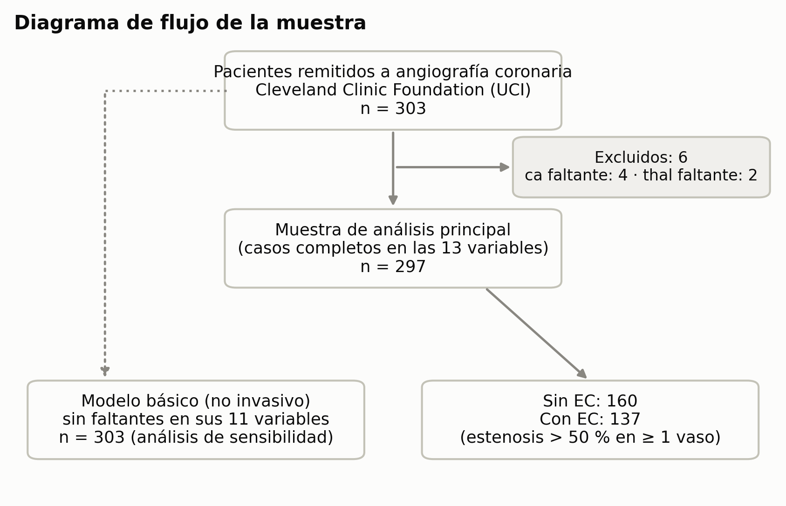

*Figura 2. Diagrama de flujo de la muestra. La flecha punteada indica el análisis de sensibilidad con n = 303.*

### 10.2 Justificación del tamaño de la muestra

| Criterio de Riley *et al.* (10) | Modelo básico (14 parámetros, AUC anticipado de 0,80) | Modelo extendido (17 parámetros, AUC anticipado de 0,85) |
|---|---|---|
| 1. Contracción ≥ 0,90 | n = 412 | n = 372 |
| 2. Optimismo del R²_Nagelkerke ≤ 0,05 | n = 316 | n = 382 |
| 3. Prevalencia ± 0,05 | n = 382 | n = 382 |
| **n requerido** | **412** | **382** |
| **n disponible** | 297 (EPV = 9,8) | 297 (EPV = 8,1) |

*EPV: eventos por parámetro (*events per variable*).*

**Interpretación.**
- La muestra es inferior a la recomendada y la prevalencia se estima con un margen de ± 5,7 %. Esto se declara como limitación.
- Es aceptable para un estudio de desarrollo con validación interna si se controla el sobreajuste. Por eso:
  - el modelo predictivo usa penalización L2;
  - se reporta el **optimismo**, que resultó pequeño (0,021 de AUC);
  - se reporta la **pendiente de calibración** fuera de muestra, que es de 0,91 en el básico (cercana al ideal de 1).

---

## 11. Recolección, gestión y análisis de la información

### 11.1 Fuentes de información

**Fuente secundaria:** UCI Machine Learning Repository, *Heart Disease*, subconjunto Cleveland (21).
- Archivo `processed.cleveland.data`, con 14 de los 76 atributos originales.
- Licencia CC BY 4.0.
- Investigadores responsables de la recolección original: Robert Detrano, M.D., Ph.D. (V.A. Medical Center, Long Beach, y Cleveland Clinic Foundation), Andras Janosi, M.D. (Budapest), William Steinbrunn, M.D. (Zúrich) y Matthias Pfisterer, M.D. (Basilea).

### 11.2 Métodos e instrumentos de recolección

No hay recolección primaria. El instrumento es la **descarga verificada** del archivo oficial, más su documentación
(`data/raw/heart-disease.names`). La procedencia está registrada en `data/raw/README.md`: URL, fecha y SHA-256.

### 11.3 Gestión y preparación de los datos

1. **Codificación y diccionario de variables:** según la documentación oficial (Anexo A).
2. **Depuración:** tipos de datos, desenlace binario y colapso de `restecg` para el modelado.
3. **Faltantes:** 6 de 303 (2 %), solo en `ca` y `thal`. Se manejan por **casos completos**; el modelo básico, que no usa esas variables, se reajusta con n = 303 como análisis de sensibilidad.
4. **Auditoría de la versión Kaggle usada en el semestre 1.** El emparejamiento de los 303 registros con la base oficial mostró:
   - **`target` invertido en el 100 % de los registros:** `target = 1` corresponde a pacientes **sin** EC;
   - **`cp`, `restecg` y `slope` recodificadas**, con las categorías en otro orden. Mapeo Kaggle → UCI: `cp` 0→4, 1→2, 2→3, 3→1; `restecg` 0→2, 1→0, 2→1; `slope` 0→3, 1→2, 2→1; `thal` 1→6, 2→3, 3→7;
   - **faltantes ocultos:** `ca = 4` (5 registros) y `thal = 0` (2 registros);
   - **un registro duplicado:** 302 pacientes únicos más una fila repetida.

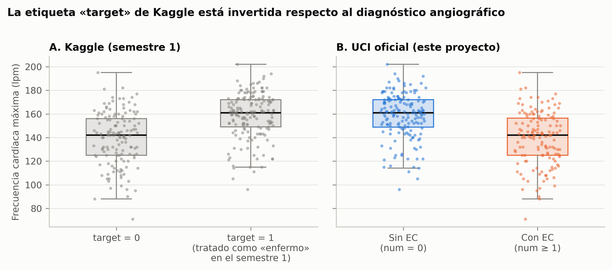

*Figura 1. Con la etiqueta de Kaggle, los «enfermos» alcanzaban una frecuencia cardíaca más alta. Con la etiqueta oficial ocurre lo contrario, que es lo fisiológicamente esperado: el paciente con isquemia tolera menos el esfuerzo.*

### 11.4 Métodos de análisis

Descritos en detalle en §8.3: descriptivo y bivariado (B), inferencial (C), predictivo (D) y validación (E).

### 11.5 Herramientas de análisis

| Herramienta | Versión | Uso |
|---|---|---|
| Python | 3.12 | Lenguaje |
| pandas / NumPy | 3.0.3 / 2.4.4 | Manejo de datos |
| SciPy | 1.17.1 | Pruebas estadísticas |
| statsmodels (22) | 0.14.6 | Regresión logística inferencial, VIF y GLM |
| scikit-learn (23) | 1.8.0 | Modelos predictivos, validación cruzada y métricas |
| matplotlib | 3.10.9 | Figuras (300 dpi, paleta validada para daltonismo) |
| Jupyter / nbconvert | 1.1.1 / 7.17 | Notebooks ejecutables |
| Git + GitHub | — | Control de versiones: `github.com/AlejandroP212/Proyecto_Final_Healtech1` |
| GNU Make | — | `make setup` · `make all` · `make verify` |

**Reproducibilidad:** `make setup && make all` regenera todos los resultados en unos 4 minutos.

### 11.6 Equipo de investigación y asesoría

| Rol | Persona | Responsabilidades |
|---|---|---|
| Coinvestigadora | Angie Milena Tobar Aguirre | Revisión documental y epidemiológica, interpretación clínica, análisis descriptivo, redacción y exposición |
| Coinvestigador | Alejandro Pardo Costo | Gestión de datos y auditoría, modelado y validación, reproducibilidad (repositorio), redacción y exposición |
| Asesora metodológica | Prof. Eliana Andrea González Artunduaga | Asesoría en el diseño de investigación, revisión del protocolo y evaluación |

*La distribución de tareas entre los coinvestigadores es una propuesta y debe ajustarse a la división real del trabajo.*

### 11.7 Consideraciones éticas y protección de datos

- **Clasificación del riesgo:** según la **Resolución 8430 de 1993** del Ministerio de Salud de Colombia, art. 11 (24), es una **investigación sin riesgo**. Usa datos secundarios de una base pública, sin intervención ni contacto con personas.
- **Consentimiento informado:** no se requiere, por tratarse de datos secundarios anonimizados.
- **Anonimización:** el donante reemplazó nombres y números de seguridad social por valores ficticios (`heart-disease.names`). No se procesan datos personales identificables, de acuerdo con la **Ley 1581 de 2012** (25).
- **Propiedad intelectual:** licencia CC BY 4.0, con cita obligatoria a los investigadores originales (§11.1).
- **Comité de ética:** no se requiere aval por ser una investigación sin riesgo con datos públicos. Si se hiciera una validación con datos colombianos, sí se requeriría.
- **Uso responsable:** el modelo es académico, no está validado externamente y **no debe usarse para decisiones clínicas**.

---

## 12. Resultados obtenidos

### 12.1 Características de la cohorte (OE1)

De 297 pacientes, 137 (46,1 %) tenían EC. Los pacientes con EC eran mayores, con mayor proporción de hombres y más frecuentemente
asintomáticos. Además, alcanzaron una frecuencia cardíaca máxima menor y presentaron más depresión del ST, más angina de esfuerzo y más hallazgos anormales en la imagen.

**Tabla 1. Características según diagnóstico angiográfico.** Continuas: mediana [RIC]. Cualitativas: n (%).

| Variable | Categoría | Total (n = 297) | Sin EC (n = 160) | Con EC (n = 137) | Prueba | p | Efecto |
|---|---|---|---|---|---|---|---|
| Edad (años) | | 56,0 [48,0–61,0] | 52,0 [44,8–59,0] | 58,0 [53,0–62,0] | Mann-Whitney | < 0,001 | r = 0,28 |
| PAS en reposo (mmHg) | | 130 [120–140] | 130 [120–140] | 130 [120–145] | Mann-Whitney | 0,023 | r = 0,15 |
| Colesterol (mg/dL) | | 243 [211–276] | 235,5 [208,8–268,2] | 253 [218–284] | Mann-Whitney | 0,047 | r = 0,13 |
| FC máxima (lpm) | | 153 [133–166] | 161 [149–172] | 142 [125–157] | Mann-Whitney | < 0,001 | r = −0,50 |
| Depresión del ST (mm) | | 0,8 [0,0–1,6] | 0,2 [0,0–1,1] | 1,4 [0,6–2,5] | Mann-Whitney | < 0,001 | r = 0,47 |
| Vasos por fluoroscopia (0–3) | | 0 [0–1] | 0 [0–0] | 1 [0–2] | Mann-Whitney | < 0,001 | r = 0,50 |
| Sexo | Hombre | 201 (67,7) | 89 (55,6) | 112 (81,8) | Chi² | < 0,001 | V = 0,28 |
| Glucemia > 120 mg/dL | Sí | 43 (14,5) | 23 (14,4) | 20 (14,6) | Chi² | 0,956 | V = 0,00 |
| Angina de esfuerzo | Sí | 97 (32,7) | 23 (14,4) | 74 (54,0) | Chi² | < 0,001 | V = 0,42 |
| Dolor torácico | Angina típica | 23 (7,7) | 16 (10,0) | 7 (5,1) | Chi² | < 0,001 | V = 0,51 |
| | Angina atípica | 49 (16,5) | 40 (25,0) | 9 (6,6) | | | |
| | No anginoso | 83 (27,9) | 65 (40,6) | 18 (13,1) | | | |
| | Asintomático | 142 (47,8) | 39 (24,4) | 103 (75,2) | | | |
| ECG en reposo | Normal | 147 (49,5) | 92 (57,5) | 55 (40,1) | Chi² Monte Carlo | 0,005 | V = 0,18 |
| | Anomalía ST-T | 4 (1,3) | 1 (0,6) | 3 (2,2) | | | |
| | Hipertrofia VI | 146 (49,2) | 67 (41,9) | 79 (57,7) | | | |
| Pendiente del ST | Ascendente | 139 (46,8) | 103 (64,4) | 36 (26,3) | Chi² | < 0,001 | V = 0,38 |
| | Plana | 137 (46,1) | 48 (30,0) | 89 (65,0) | | | |
| | Descendente | 21 (7,1) | 9 (5,6) | 12 (8,8) | | | |
| Talio | Normal | 164 (55,2) | 127 (79,4) | 37 (27,0) | Chi² | < 0,001 | V = 0,53 |
| | Defecto fijo | 18 (6,1) | 6 (3,8) | 12 (8,8) | | | |
| | Defecto reversible | 115 (38,7) | 27 (16,9) | 88 (64,2) | | | |

*Ninguna variable continua fue normal en ambos grupos (Shapiro-Wilk), por lo que todas se compararon con Mann-Whitney.
r = correlación biserial por rangos (positiva = mayor en el grupo con EC). V = V de Cramér. Fuente: `results/tables/tabla1_caracteristicas.csv`.*

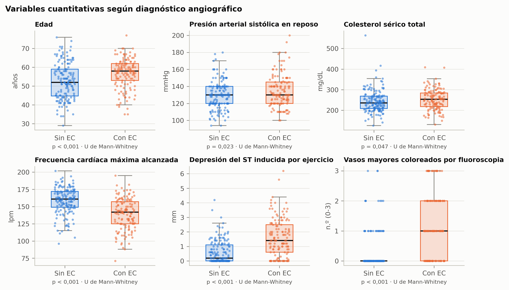

*Figura 3. Distribución de las variables cuantitativas según el diagnóstico.*

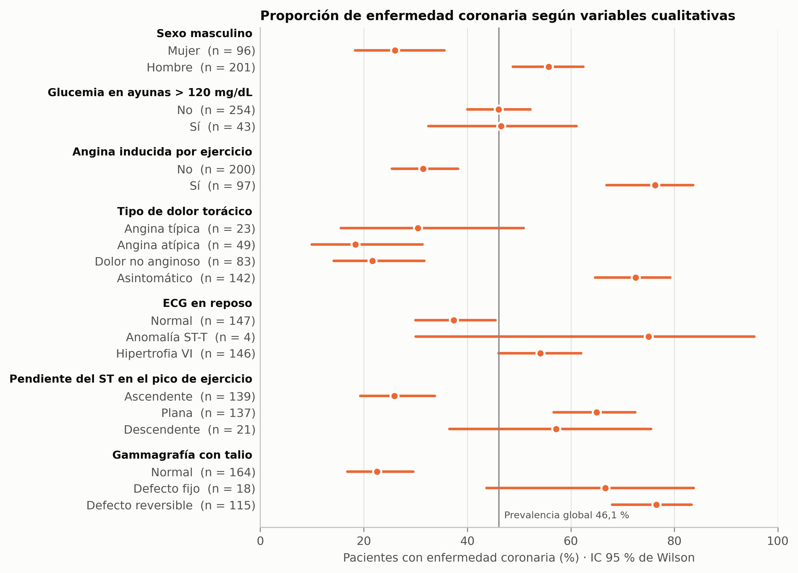

*Figura 4. Proporción de EC por categoría, con IC 95 % de Wilson. La línea vertical marca la prevalencia global.*

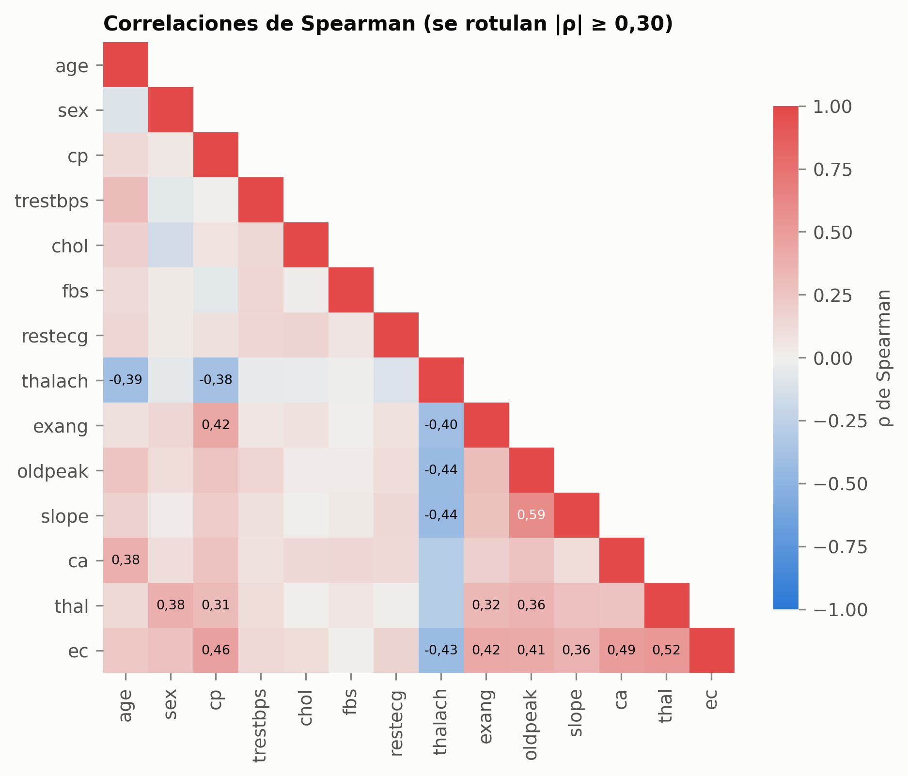

*Figura 5. Correlaciones de Spearman. Las más fuertes con `ec` son la gammagrafía con talio, el dolor torácico, el número de vasos y los marcadores de la prueba de esfuerzo.*

### 12.2a Paso preliminar: ¿por qué no regresión lineal?

| Modelo | Hallazgo | Supuestos | Veredicto |
|---|---|---|---|
| MLP (Y = `ec`) | R² = 0,47, pero **43 de 297 predicciones fuera de [0, 1]** (−0,31 a 1,19) | Shapiro-Wilk p = 0,075; **Breusch-Pagan p = 0,003** | Rechazado: no produce probabilidades válidas |
| OLS presión arterial | R² = 0,11. Edad: +0,50 mmHg por año (p < 0,001); glucemia > 120: +7,5 mmHg (p = 0,008) | **Shapiro-Wilk p = 0,004; Breusch-Pagan p = 0,016**. Varianza residual de 338 mmHg² en los pacientes de 55 años o más, frente a 212 en los menores | Rechazado por control de calidad |

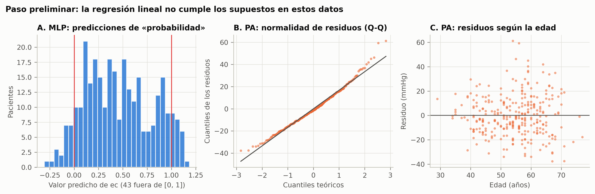

*Figura 12. (A) El MLP predice «probabilidades» imposibles. (B) Los residuos del modelo de presión arterial se apartan de la normalidad en la cola derecha. (C) La dispersión de los residuos aumenta con la edad (heterocedasticidad).*

**Conclusión:** con un desenlace binario, la regresión lineal no es válida. Esto justifica la **regresión logística**, que acota la probabilidad entre 0 y 1. El modelo de presión arterial muestra que un modelo se aprueba solo si cumple sus supuestos.

### 12.2 Factores asociados (OE2, H-1)

**Tabla 2. OR crudos y ajustados (regresión logística por máxima verosimilitud).**

| Variable | OR crudo (IC 95 %) | p | **OR ajustado básico (IC 95 %)** | p | OR ajustado extendido (IC 95 %) | p |
|---|---|---|---|---|---|---|
| Edad (por 10 años) | 1,70 (1,29–2,23) | < 0,001 | 1,25 (0,82–1,91) | 0,294 | 0,87 (0,54–1,42) | 0,580 |
| **Sexo masculino** | 3,57 (2,10–6,10) | < 0,001 | **7,48 (3,25–17,20)** | **< 0,001** | 4,66 (1,66–13,08) | 0,003 |
| Dolor: angina atípica (vs. típica) | 0,51 (0,16–1,62) | 0,255 | 2,68 (0,66–10,81) | 0,166 | 3,47 (0,77–15,69) | 0,107 |
| Dolor: no anginoso (vs. típica) | 0,63 (0,23–1,77) | 0,384 | 1,47 (0,44–4,96) | 0,533 | 1,28 (0,35–4,71) | 0,705 |
| **Dolor: asintomático (vs. típica)** | 6,04 (2,31–15,79) | < 0,001 | **10,60 (3,17–35,40)** | **< 0,001** | 8,08 (2,19–29,83) | 0,002 |
| PAS en reposo (por 10 mmHg) | 1,19 (1,05–1,36) | 0,009 | 1,21 (0,99–1,47) | 0,059 | 1,28 (1,02–1,59) | 0,029 |
| Colesterol (por 40 mg/dL) | 1,13 (0,95–1,36) | 0,170 | 1,21 (0,92–1,58) | 0,175 | 1,19 (0,87–1,63) | 0,268 |
| Glucemia > 120 mg/dL | 1,02 (0,53–1,95) | 0,956 | 0,94 (0,36–2,42) | 0,894 | 0,55 (0,17–1,81) | 0,325 |
| ECG de reposo anormal | 2,02 (1,27–3,21) | 0,003 | 1,46 (0,75–2,84) | 0,259 | 1,61 (0,76–3,41) | 0,210 |
| **FC máxima (por 10 lpm)** | 0,64 (0,56–0,73) | < 0,001 | **0,82 (0,68–1,00)** | **0,048** | 0,84 (0,67–1,04) | 0,107 |
| Angina de esfuerzo | 7,00 (4,02–12,19) | < 0,001 | 1,90 (0,89–4,07) | 0,098 | 2,03 (0,86–4,82) | 0,107 |
| **Depresión del ST (por mm)** | 2,50 (1,91–3,28) | < 0,001 | **1,82 (1,23–2,69)** | **0,003** | 1,43 (0,92–2,25) | 0,115 |
| Pendiente del ST plana (vs. ascendente) | 5,30 (3,16–8,90) | < 0,001 | 2,11 (0,95–4,72) | 0,068 | 3,17 (1,25–8,02) | 0,015 |
| Pendiente del ST descendente (vs. ascendente) | 3,81 (1,48–9,80) | 0,005 | 0,69 (0,12–3,80) | 0,668 | 1,68 (0,28–10,19) | 0,572 |
| Vasos por fluoroscopia (por vaso) | 3,48 (2,46–4,93) | < 0,001 | — | — | 3,71 (2,15–6,41) | < 0,001 |
| Talio: defecto fijo (vs. normal) | 6,86 (2,41–19,54) | < 0,001 | — | — | 0,99 (0,21–4,64) | 0,987 |
| Talio: defecto reversible (vs. normal) | 11,19 (6,35–19,70) | < 0,001 | — | — | 4,03 (1,75–9,27) | 0,001 |

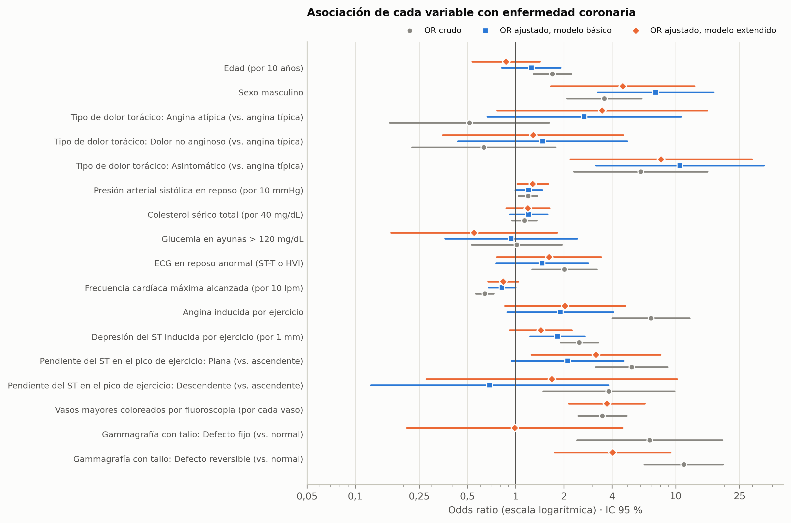

*Figura 6. OR crudos (gris) y ajustados en los modelos básico (azul) y extendido (naranja), en escala logarítmica.*

**OR por rangos clínicos (crudos, tablas 2 × 2).**

| Rango (expuesto) | EC en expuestos | EC en no expuestos | OR (IC 95 %) | p |
|---|---|---|---|---|
| Edad ≥ 55 años | 95/159 (59,7 %) | 42/138 (30,4 %) | 3,39 (2,10–5,49) | < 0,001 |
| PAS en reposo ≥ 140 mmHg | 54/98 (55,1 %) | 83/199 (41,7 %) | 1,72 (1,05–2,79) | 0,029 |
| Colesterol ≥ 240 mg/dL | 79/155 (51,0 %) | 58/142 (40,8 %) | 1,51 (0,95–2,38) | 0,080 |
| FC máxima < 85 % de la esperada | 65/90 (72,2 %) | 72/207 (34,8 %) | **4,88 (2,83–8,39)** | < 0,001 |
| Depresión del ST ≥ 1 mm | 91/136 (66,9 %) | 46/161 (28,6 %) | **5,06 (3,08–8,29)** | < 0,001 |
| FC máxima ≤ 162 lpm (corte del Taller 2) | 117/206 (56,8 %) | 20/91 (22,0 %) | 4,67 (2,65–8,23) | < 0,001 |

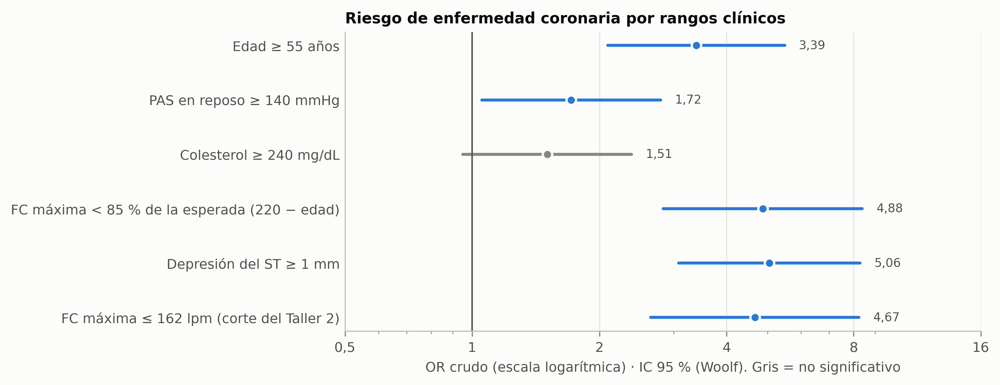

*Figura 13. OR crudos por rangos clínicos. Los marcadores de la prueba de esfuerzo son los de mayor riesgo; el colesterol alto no es significativo. Con la etiqueta correcta, es una FC **≤ 162 lpm** la que se asocia con la EC; en el Taller 2 se había concluido lo contrario por la etiqueta invertida.*

**Diagnóstico de los modelos.**

| Indicador | Básico (n = 297) | Extendido (n = 297) | Básico (n = 303, sensibilidad) |
|---|---|---|---|
| Razón de verosimilitud χ² (gl), p | 174,7 (14), < 0,001 | 218,3 (17), < 0,001 | 180,7 (14), < 0,001 |
| R² de Nagelkerke | 0,594 | 0,695 | 0,600 |
| Hosmer-Lemeshow, p | 0,532 | 0,648 | 0,457 |
| VIF máximo | 4,19 | 4,34 | 4,26 |
| Box-Tidwell, p mínimo | 0,224 | 0,281 | 0,236 |
| AIC | 265,2 | 227,7 | 267,3 |
| Eventos por parámetro | 9,8 | 8,1 | 9,9 |

**Interpretación.**
- **H-1:** se rechaza H0 (p < 0,001). Se cumplen los supuestos: logit lineal, sin colinealidad relevante y buen ajuste.
- **Factores de riesgo independientes sólidos:** sexo masculino, dolor torácico asintomático (isquemia silente) y depresión del ST con el esfuerzo. Son estables entre n = 297 y n = 303.
- **FC máxima:** es **protectora**, pero con significancia limítrofe (p = 0,048; p = 0,051 con n = 303).
- **Factores que pierden su efecto al ajustar:** la edad, la angina de esfuerzo y la pendiente del ST, por su correlación con otras variables de esfuerzo y por confusión con el sexo.
- **Colesterol:** no se asocia ni en el análisis crudo ni en el ajustado.
- **Modelo extendido:** el número de vasos (OR 3,71 por vaso) y el defecto reversible en la gammagrafía con talio (OR 4,03) son los predictores dominantes.

### 12.3 Desempeño predictivo (OE3, OE4)

**Tabla 3. Desempeño en validación cruzada 5 × 20 y fuera de muestra.**

| Modelo | AUC CV media (P2,5–P97,5) | AUC fuera de muestra (IC 95 % DeLong) | Brier | Pendiente de calibración | Sens. / Esp. (umbral 0,5) | Esp. con sens. ≥ 90 % |
|---|---|---|---|---|---|---|
| M0 · RL 4 continuas (semestre 1) | 0,749 (0,612–0,865) | 0,746 (0,690–0,801) | 0,205 | 0,93 | 0,650 / 0,769 | 0,344 |
| **M1 · RL básica (no invasiva)** | **0,874 (0,794–0,949)** | **0,875 (0,836–0,914)** | 0,146 | **0,91** | 0,752 / 0,844 | 0,613 |
| M2 · RL extendida (+ imagen) | 0,909 (0,829–0,964) | 0,904 (0,870–0,938) | 0,120 | 0,84 | 0,788 / 0,875 | 0,700 |
| M3 · Árbol CART (extendido) | 0,842 (0,715–0,940) | 0,847 (0,802–0,893) | 0,163 | 0,26 | 0,737 / 0,875 | 0,519 |
| M4 · Random Forest (extendido) | 0,910 (0,833–0,964) | 0,905 (0,872–0,938) | 0,127 | 1,59 | 0,759 / 0,875 | 0,719 |

**Corrección de optimismo (bootstrap, 500 réplicas):**
- M1: AUC aparente de 0,901, optimismo de 0,021, **AUC corregido de 0,880**.
- M2: AUC aparente de 0,935, optimismo de 0,020, **AUC corregido de 0,915**.

**Matriz de confusión fuera de muestra, M1:**

| Umbral | VP | FN | VN | FP | Sensibilidad | Especificidad | VPP | VPN | Exactitud |
|---|---|---|---|---|---|---|---|---|---|
| 0,50 | 103 | 34 | 135 | 25 | 0,752 | 0,844 | 0,805 | 0,799 | 0,801 |
| 0,24 (sens. ≥ 90 %) | 124 | 13 | 98 | 62 | 0,905 | 0,613 | 0,667 | 0,883 | 0,747 |

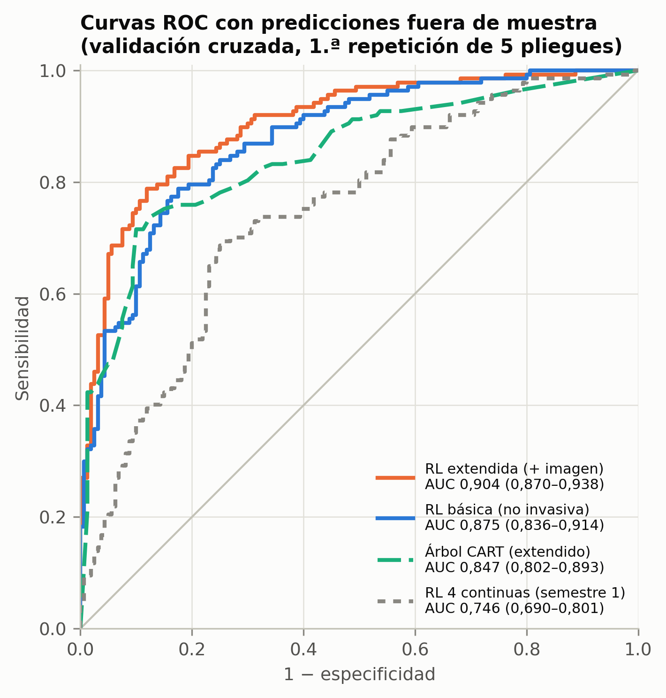

*Figura 7. Curvas ROC con predicciones fuera de muestra.*

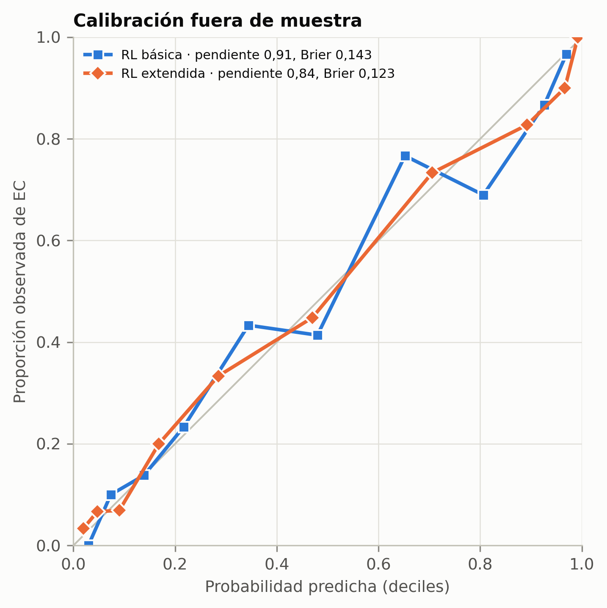

*Figura 8. Calibración fuera de muestra de los modelos de regresión logística.*

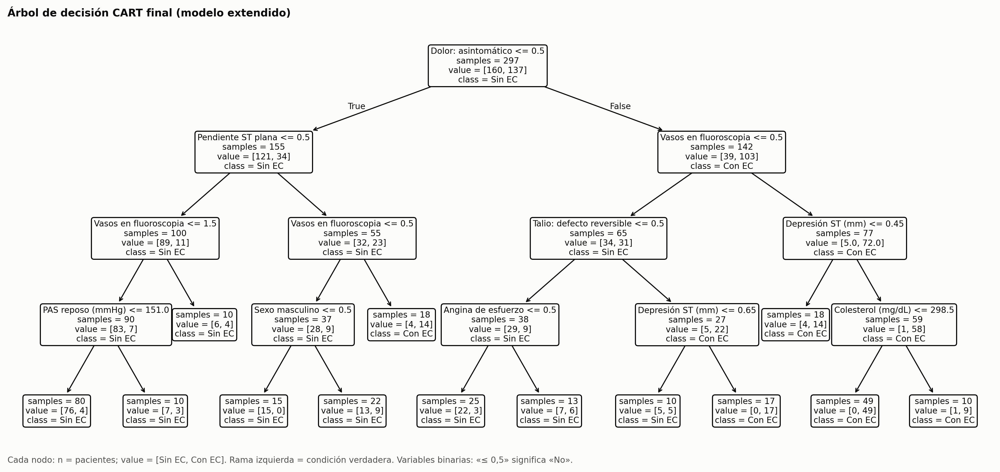

*Figura 9. Árbol CART final: profundidad 4 y 10 pacientes como mínimo por hoja. La primera división es el dolor torácico asintomático; las siguientes, el número de vasos, el talio con defecto reversible y la pendiente del ST.*

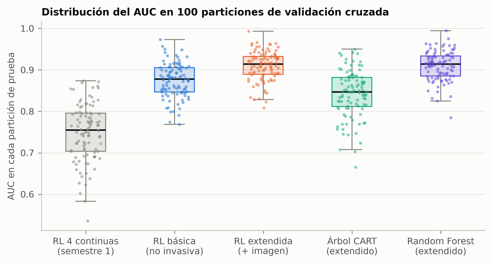

*Figura 10. AUC en cada una de las 100 particiones. Muestra cuánto puede variar una evaluación basada en una sola partición.*

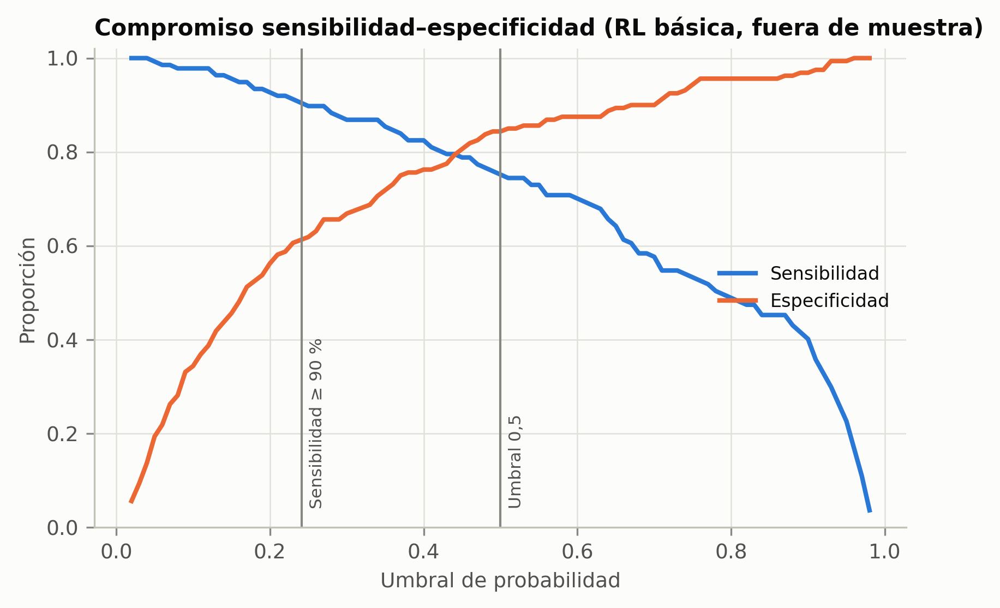

*Figura 11. Compromiso entre sensibilidad y especificidad del modelo básico según el umbral.*

### 12.4 Contraste de hipótesis

| Hipótesis | Resultado | Decisión |
|---|---|---|
| **H-1** · Asociación | LR χ² = 174,7; gl = 14; p < 0,001 | **Se rechaza H0.** Al menos un factor se asocia con la EC. |
| **H-2** · AUC básico > 0,80 | IC 95 % de DeLong 0,836–0,914; AUC corregido por optimismo 0,880 | **Se rechaza H0.** La discriminación es clínicamente útil. |
| **H-3** · Aporte de la imagen | ΔAUC = 0,035 (IC 95 % 0,008–0,062); p = 0,012 (Nadeau-Bengio); p = 0,021 (DeLong); LR χ² = 43,6, gl = 3, p < 0,001 | **Se rechaza H0.** La imagen mejora la discriminación, aunque de forma modesta. |
| **H-4** · Árbol vs. RL | ΔAUC (RL − árbol) = 0,067 (IC 95 % 0,021–0,113); p = 0,004 (Nadeau-Bengio); p = 0,003 (DeLong) | **Se rechaza H0.** La RL discrimina mejor que el árbol. |
| *Complementaria* · RL vs. Random Forest | ΔAUC = −0,001 (IC 95 % −0,018 a 0,017); p = 0,94 | No hay diferencia: el modelo complejo no aporta. |
| *Complementaria* · Mejora frente al semestre 1 | ΔAUC (M1 − M0) = 0,125 (IC 95 % 0,070–0,180); p < 0,001 | Incluir todos los factores no invasivos mejora sustancialmente el modelo. |

---

## 13. Discusión

**Hallazgos principales.**
- Con información obtenible sin imagen (consulta, ECG y prueba de esfuerzo), un modelo logístico discrimina la EC con un AUC de 0,87–0,88 y buena calibración.
- La imagen aporta poco (+ 0,035).
- El modelo simple (RL) iguala al complejo (Random Forest) y supera al árbol.

**Coherencia con la literatura.**
- El **dolor torácico** y el **sexo** son los pilares de las reglas de probabilidad pretest desde Diamond y Forrester (4) hasta el CAD Consortium (6), y aquí son los predictores más fuertes.
- La **asociación inversa con la FC máxima** es fisiológicamente esperable: el miocardio isquémico limita la capacidad de esfuerzo y la respuesta cronotrópica. Corregir la etiqueta invirtió la conclusión del semestre 1 (FC alta = riesgo), que no tenía sustento fisiológico.
- La **depresión del ST** es el marcador electrocardiográfico clásico de isquemia de esfuerzo (3).

**El colesterol.** Su falta de asociación es contraintuitiva para un factor de riesgo clásico, pero es coherente con tres hechos:
1. el colesterol daña a lo largo de décadas, mientras que los marcadores de esfuerzo reflejan la enfermedad ya instaurada;
2. en una cohorte remitida (sesgo de espectro), ambos grupos tienen perfiles de riesgo elevados;
3. no se conoce el uso de estatinas.

Esto **no** implica que el colesterol carezca de importancia en la prevención.

**Comparación con Chandrasekhar y Peddakrishna (2023) (7).** Ellos reportaron una exactitud del 90,2 % y una sensibilidad del 100 % para la regresión logística, con 61 pacientes de prueba. Nuestras estimaciones (exactitud de 0,80 del modelo básico con umbral 0,5; AUC de 0,90–0,91 del modelo extendido) son menores, pero más robustas, por tres razones:
- La figura 10 muestra que, con una sola partición, el AUC del mismo modelo puede variar entre 0,83 y 0,96. Una métrica sobre 61 pacientes tiene un margen de error amplio.
- Reportamos la calibración y la corrección de optimismo.
- Usamos la etiqueta oficial. Conviene verificar qué versión de los datos usaron ellos.

Ambos estudios coinciden en la dirección: **la regresión logística es competitiva frente a algoritmos más complejos** en esta base.

**¿Por qué la RL supera al árbol?**
- El árbol divide la población en pocos grupos, por lo que sus probabilidades son escalonadas y extremas (pendiente de calibración de 0,26, señal de sobreajuste).
- Es inestable: los hiperparámetros óptimos cambiaron entre particiones; los más frecuentes se eligieron solo en el 32 % de ellas.
- Su valor está en la **interpretabilidad**: la figura 9 traduce el modelo en reglas clínicas sencillas.

**Implicación clínica.** Con el umbral de sensibilidad del 90 %:
- el modelo básico descarta correctamente al 61 % de los pacientes sin EC;
- su VPN es del 88 %;
- clasifica erróneamente como sanos a 13 de 137 enfermos.

Esto sugiere que podría servir para **priorizar** a quién remitir a angiografía, pero **no para descartar de forma segura** sin validación externa.

**Fortalezas.**
- Fuente oficial auditada.
- Comparación de algoritmos sobre las mismas particiones.
- Validación cruzada repetida y bootstrap.
- Calibración reportada.
- Reproducibilidad completa.

**Debilidades.** Ver §5.

**Trabajo futuro.**
1. Validación externa con las otras tres sedes de UCI (Hungría, Suiza y Long Beach).
2. Validación con datos colombianos, con aval ético.
3. Incorporar factores ausentes en la base (tabaquismo, diabetes, IMC).
4. Análisis de curva de decisión (*decision curve analysis*) para cuantificar el beneficio clínico neto.

---

## 14. Conclusiones

1. **Factores de riesgo y hallazgos asociados.** El sexo masculino, el dolor torácico asintomático y la depresión del ST con el esfuerzo se asocian de forma independiente con la enfermedad coronaria angiográfica. Una mayor frecuencia cardíaca máxima es protectora, con evidencia limítrofe. El colesterol no se asoció de forma independiente en esta cohorte.
2. **Predicción con variables de bajo costo.** Un modelo de regresión logística con 11 variables no invasivas discrimina bien (AUC de 0,874; 0,880 corregido por optimismo) y está bien calibrado.
3. **Aporte de la imagen.** La fluoroscopia y la gammagrafía con talio mejoran la discriminación de forma significativa pero modesta (+ 0,035).
4. **Algoritmos.** La regresión logística supera al árbol de decisión e iguala al Random Forest, con mejor calibración e interpretabilidad. El árbol es útil para explicar las reglas, no para predecir.
5. **Calidad de los datos.** La versión de Kaggle de esta base tiene la etiqueta invertida. Verificar la fuente cambió las conclusiones del proyecto, lo que confirma que el control de calidad de los datos es parte del método científico.

---

## 15. Administración del proyecto

### 15.1 Actividades y cronograma

| Fase | Actividad | Periodo (2026) | Responsables | Dependencia | Producto verificable |
|---|---|---|---|---|---|
| **Semestre 1 · HealthTech 1** | | | | | |
| F1 | Selección de la base y revisión inicial | Feb–mar* | Ambos | — | Taller 1 |
| F2 | EDA y primeros modelos (lineal y logística) | Mar–abr | Ambos | F1 | Notebook del semestre 1 (historial de git) |
| F3 | Presentación y paper preliminar | May | Ambos | F2 | Presentación y paper del semestre 1 |
| **Semestre 2 · HealthTech 2** | | | | | |
| F4 | Ficha de la base: procedencia, población, epidemiología y costos | Ago–sep | Ambos | F3 | Taller 3 |
| F5 | Estructura del proyecto: problema, justificación, objetivos e hipótesis | Sep–oct | Ambos | F4 | Presentación del tablero |
| F6 | Auditoría de datos y migración a la base oficial de UCI | Nov (sem. 1) | Ambos | F5 | Notebook 01, `data/raw/README.md` |
| F7 | Reanálisis: descriptivo, asociación, predicción y validación | Nov (sem. 1–2) | Ambos | F6 | Notebooks 02–05, `results/` |
| F8 | Documento del proyecto y paper final (protocolo + resultados) | Nov (sem. 2) | Ambos | F7 | Este documento y `paper/` |
| F9 | Presentación final y evaluación por pares | 3–14 nov | Ambos | F8 | Presentación de 30–45 min |
| F10 | Trabajo futuro: validación externa | 2027 | Por definir | F9 | Propuesta de continuación |

*Las fechas del semestre 1 (F1–F3) son aproximadas; ajustarlas a las fechas reales de entrega.*

### 15.2 Instituciones participantes

| Institución | Función | Responsabilidades y recursos |
|---|---|---|
| **Universidad Externado de Colombia**, Pregrado en Ciencia de Datos aplicada a la Salud | Institución ejecutora | Asesoría docente, espacios académicos y evaluación |
| **UCI Machine Learning Repository** (University of California, Irvine) | Proveedor de los datos | Custodia y distribución pública de la base (CC BY 4.0) |
| **Cleveland Clinic Foundation** (y V.A. Medical Center, Long Beach) | Origen de los datos | Recolección original (Detrano *et al.*, 1989). Sin participación activa. |

---

## 16. Presupuesto y fuentes de financiación

*Presupuesto de referencia en pesos colombianos (COP). Las tarifas son supuestos razonables para un proyecto académico y deben ajustarse.*

| Rubro | Detalle | Cantidad | Valor unitario | Total (COP) | Fuente |
|---|---|---|---|---|---|
| **Personal científico** | 2 coinvestigadores estudiantes | 2 × 120 h | $25.000/h | $6.000.000 | Aporte en especie (estudiantes) |
| **Asesoría especializada** | Docente asesora en metodología | 20 h | $90.000/h | $1.800.000 | Contrapartida institucional (U. Externado) |
| **Equipos** | Uso de 2 computadores personales (depreciación proporcional) | 2 | $200.000 | $400.000 | Aporte en especie |
| **Bases de datos y licencias** | UCI Heart Disease (CC BY 4.0); Python y librerías de software libre | — | $0 | $0 | — |
| **Recursos informáticos** | GitHub (repositorio público, plan gratuito) | — | $0 | $0 | — |
| **Recolección y almacenamiento** | Datos secundarios, sin recolección primaria | — | $0 | $0 | — |
| **Divulgación** | Impresión de póster o material para la socialización | 1 | $150.000 | $150.000 | Recursos propios |
| **Costos administrativos** | Conectividad y energía (proporcional) | 4 meses | $50.000 | $200.000 | Aporte en especie |
| **Imprevistos** | 5 % del subtotal | — | — | $427.500 | Recursos propios |
| **Total estimado** | | | | **$8.977.500** | |

**Fuentes de financiación:** no hay financiación externa.
- El 94 % del costo es aporte en especie de los investigadores y contrapartida institucional en horas de asesoría.
- El desembolso efectivo es de unos $577.500 (divulgación e imprevistos), con recursos propios.

**Fuentes potenciales para la fase de validación externa:**
- convocatorias internas de investigación de la Universidad Externado;
- convocatorias de Minciencias para semilleros y jóvenes investigadores.

---

## 17. Anexos

| Anexo | Contenido | Ubicación |
|---|---|---|
| **A** | Diccionario de variables y formato de extracción (definición conceptual y operacional, unidad, categorías, faltantes) | [`docs/diccionario_variables.md`](diccionario_variables.md) |
| **B** | Procedencia de los datos, verificación de integridad y auditoría de Kaggle | [`data/raw/README.md`](../data/raw/README.md) |
| **C** | Código reproducible (notebooks con salidas) | [`notebooks/`](../notebooks) |
| **D** | Matriz de correspondencia con la rúbrica de evaluación | Abajo |
| **E** | Trazabilidad de cambios frente al semestre 1 | Abajo |
| **F** | Resultados completos legibles por máquina | [`results/resultados.json`](../results/resultados.json), [`results/RESUMEN_RESULTADOS.md`](../results/RESUMEN_RESULTADOS.md) |
| — | Cronograma y presupuesto desagregados | §15–16 |
| — | Autorizaciones de acceso a la información | No aplica: datos públicos, CC BY 4.0 |
| — | Documentos para el comité de ética | No aplica: investigación sin riesgo (§11.7) |
| — | Hojas de vida, cartas de aval y RUT | No aplica: proyecto académico sin financiación externa |

### Anexo D · Correspondencia con la rúbrica de evaluación por pares

| Bloque | Criterio | Sección |
|---|---|---|
| **A. Título** | Claro, representa el problema, identifica la población, coherente con la metodología | §1 |
| **B. Introducción** | Contexto epidemiológico · conceptos · problema · métodos existentes · vacío · justificación · objetivo | §2, §3.1–3.3, §6 |
| **C. Problema** | Qué ocurre · causas · consecuencias · alternativas · cambios esperados | §3.4 |
| **D. Hipótesis** | H0 · H1 · coherencia | §9 |
| **E. Objetivo general** | Claro, medible, coherente; población y alcance | §6 |
| **F. Objetivos específicos** | Formulados, coherentes, medibles, secuencia lógica | §6 |
| **G. Metodología** | Universo, población, unidad de análisis | §10.1 |
| | Muestra y justificación del tamaño | §10.1–10.2 |
| | Criterios de inclusión y exclusión · muestreo · ámbito y periodo | §10.1 |
| | Métodos y técnicas | §8.3 |
| | Definición conceptual y operacional · clasificación de variables | §8.2, Anexo A |
| | Control de calidad | §8.4 |
| | Fuentes · instrumentos · gestión y depuración | §11.1–11.3 |
| | Métodos de análisis · herramientas | §8.3, §11.5 |
| | Equipo y asesorías · ética y protección de datos | §11.6–11.7 |
| **H. Viabilidad** | Cronograma · responsables · productos | §15.1 |
| | Instituciones · recursos | §15.2 |
| | Presupuesto · financiación · soportes | §16, §17 |
| **I. Referencias** | Pertinentes, confiables, estilo Vancouver | §18 |
| **J. Presentación** | Secuencia, dominio, tiempo, recursos visuales, preguntas | Presentación final (`presentacion/`) |

### Anexo E · Cambios frente al semestre 1

| Semestre 1 | Ahora | Motivo |
|---|---|---|
| CSV de Kaggle | Base oficial de UCI | Etiqueta invertida y faltantes ocultos en Kaggle |
| «FC máxima > 162 lpm = mayor riesgo (OR 9,17)» | FC ≤ 162 lpm = **mayor** riesgo (OR crudo 4,67); FC > 162 es protectora (OR 0,21). Ajustado: OR 0,82 por cada 10 lpm (p = 0,048) | Consecuencia de la etiqueta invertida |
| RL con 4 variables continuas; partición única 80/20; AUC de 0,838 | RL básica y extendida; validación cruzada 5 × 20; AUC de 0,874 y 0,909 | Con validación rigurosa, el modelo de 4 variables tiene un AUC de 0,749 |
| Tabla de valores p de 12 variables junto a un modelo de 4 | Un modelo explicativo por conjunto de variables, con diagnósticos | Coherencia entre el modelo y la tabla |
| Regresión lineal de presión arterial + Breusch-Pagan | Se conserva como **paso preliminar** (§8.3-C0, §12.2a), junto con el MLP | Justifica la elección de la regresión logística y sirve de ejemplo de control de calidad |
| Árbol usado para buscar umbrales | Árbol como modelo predictivo, con validación anidada, más el árbol final interpretable | Evaluación comparable con la RL |
| Hipótesis sin H0/H1; sin cálculo de muestra, calibración ni ética | §9, §10.2, §8.3-E, §11.7 | Requisitos de la rúbrica y del protocolo |

---

## 18. Referencias bibliográficas (Vancouver)

1. Institute for Health Metrics and Evaluation. Cardiovascular diseases caused 1 in 3 global deaths in 2023 [Internet]. Seattle: IHME; 2025.
2. Deloitte; Revista Semana. El costo de las enfermedades del corazón en Colombia. Bogotá; 2015.
3. Vrints C, Andreotti F, Koskinas KC, Rossello X, Adamo M, Ainslie J, et al. 2024 ESC Guidelines for the management of chronic coronary syndromes. Eur Heart J. 2024;45(36):3415-537.
4. Diamond GA, Forrester JS. Analysis of probability as an aid in the clinical diagnosis of coronary-artery disease. N Engl J Med. 1979;300(24):1350-8.
5. Detrano R, Janosi A, Steinbrunn W, Pfisterer M, Schmid JJ, Sandhu S, et al. International application of a new probability algorithm for the diagnosis of coronary artery disease. Am J Cardiol. 1989;64(5):304-10.
6. Genders TSS, Steyerberg EW, Alkadhi H, Leschka S, Desbiolles L, Nieman K, et al. A clinical prediction rule for the diagnosis of coronary artery disease: validation, updating, and extension. Eur Heart J. 2011;32(11):1316-30.
7. Chandrasekhar N, Peddakrishna S. Enhancing heart disease prediction accuracy through machine learning techniques and optimization. Processes. 2023;11(4):1210.
8. Van Calster B, McLernon DJ, van Smeden M, Wynants L, Steyerberg EW. Calibration: the Achilles heel of predictive analytics. BMC Med. 2019;17(1):230.
9. Collins GS, Reitsma JB, Altman DG, Moons KGM. Transparent reporting of a multivariable prediction model for individual prognosis or diagnosis (TRIPOD): the TRIPOD statement. BMJ. 2015;350:g7594.
10. Riley RD, Ensor J, Snell KIE, Harrell FE Jr, Martin GP, Reitsma JB, et al. Calculating the sample size required for developing a clinical prediction model. BMJ. 2020;368:m441.
11. Revista Colombiana de Cardiología. Estimación de los costos directos de los eventos coronarios en Colombia. Rev Colomb Cardiol. 2018.
12. *Estudio de costos del síndrome coronario agudo en España (€14.069 por caso), citado en el Taller 3. Completar los datos bibliográficos.*
13. Breiman L, Friedman JH, Olshen RA, Stone CJ. Classification and regression trees. Belmont (CA): Wadsworth; 1984.
14. Harrell FE Jr. Regression modeling strategies: with applications to linear models, logistic and ordinal regression, and survival analysis. 2nd ed. Cham: Springer; 2015.
15. Shapiro SS, Wilk MB. An analysis of variance test for normality (complete samples). Biometrika. 1965;52(3-4):591-611.
16. Hosmer DW, Lemeshow S, Sturdivant RX. Applied logistic regression. 3rd ed. Hoboken (NJ): Wiley; 2013.
17. Breiman L. Random forests. Mach Learn. 2001;45(1):5-32.
18. DeLong ER, DeLong DM, Clarke-Pearson DL. Comparing the areas under two or more correlated receiver operating characteristic curves: a nonparametric approach. Biometrics. 1988;44(3):837-45.
19. Sun X, Xu W. Fast implementation of DeLong's algorithm for comparing the areas under correlated receiver operating characteristic curves. IEEE Signal Process Lett. 2014;21(11):1389-93.
20. Nadeau C, Bengio Y. Inference for the generalization error. Mach Learn. 2003;52(3):239-81.
21. Janosi A, Steinbrunn W, Pfisterer M, Detrano R. Heart Disease [dataset]. UCI Machine Learning Repository; 1988. doi:10.24432/C52P4X.
22. Seabold S, Perktold J. Statsmodels: econometric and statistical modeling with Python. In: Proceedings of the 9th Python in Science Conference; 2010. p. 92-6.
23. Pedregosa F, Varoquaux G, Gramfort A, Michel V, Thirion B, Grisel O, et al. Scikit-learn: machine learning in Python. J Mach Learn Res. 2011;12:2825-30.
24. Ministerio de Salud de Colombia. Resolución 8430 de 1993, por la cual se establecen las normas científicas, técnicas y administrativas para la investigación en salud. Bogotá; 1993.
25. Congreso de la República de Colombia. Ley Estatutaria 1581 de 2012, por la cual se dictan disposiciones generales para la protección de datos personales. Bogotá; 2012.
26. Stark B, Johnson C, Roth GA. Global prevalence of coronary artery disease: an update from the Global Burden of Disease Study. J Am Coll Cardiol. 2024;83(13 Suppl):2320.

> **Pendiente antes de la entrega:** verificar contra la fuente original las referencias 1, 2, 11 y 12, que provienen de los
> talleres del semestre (autores, año y URL), y la 26. Las demás son referencias metodológicas estándar.
